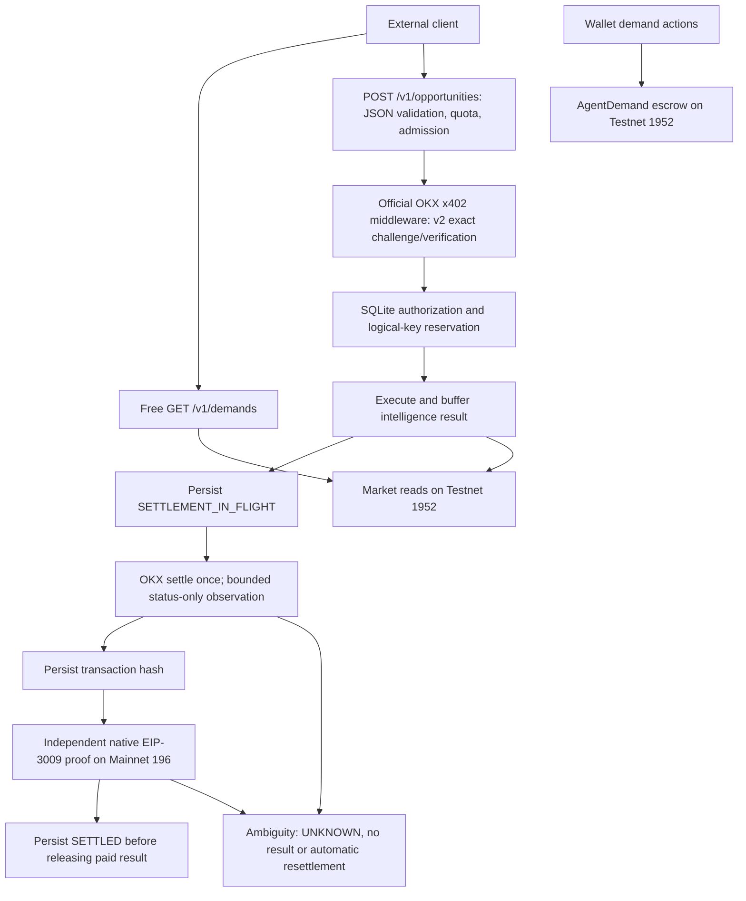
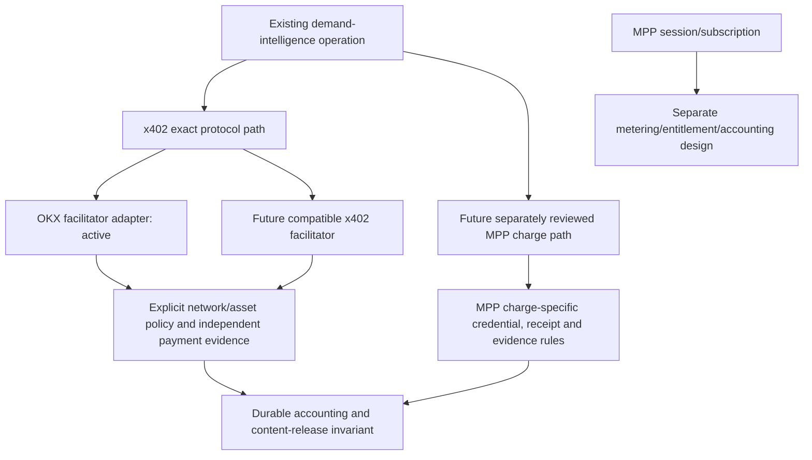

# Agent readiness and payment extensibility audit

Audit date: 26 October 2026 (Asia/Jakarta). Repository baseline: `923ff6804ccc877853581508598d32a850e59c72`.

## Scope and source of truth

The latest remote `main` was fetched before creating `feat/agent-api-discovery`. [PR #17](https://github.com/riyannode/UNMET/pull/17) merged on 25 October 2026 at 18:50:29 UTC as `aec576461356cd6cfd76090c0d974b4a36155e72`. [PR #19](https://github.com/riyannode/UNMET/pull/19) merged on 26 October at 03:11:55 UTC as `923ff6804ccc877853581508598d32a850e59c72`. No open PRs were returned at audit time. The new branch includes both implementations; #19 is not an outstanding conflicting branch.

Current product ownership remains [PRD](PRD.md), version 1.2. The [Future Implementation roadmap](FUTURE_IMPLEMENTATION.md), V2.0, explicitly remains proposed. Gate 0 validation Worker, RFQ, Service Registry, Service Discovery and Capability Resolver are not implemented or advertised as working APIs here. Demand escrow and paid intelligence are separate operations.

This audit inspected the Express API, payment configuration/factory, bounded upstream transport, durable payment wrapper, identity/confirmation/store/operator modules and regressions; frontend routing and public build; Caddy, Docker, Compose and legacy Vercel configuration; CI and current product/operations documentation. The owner confirmed that **VPS is the only active deployment** and Vercel deployments have been removed. Existing Vercel source configuration is retained unchanged; this patch targets Caddy/Docker. Runtime measurements below are independent of repository claims.

## Measured public deployment

Initial HTTPS probes ran at approximately 10:20–10:27 WIB (03:20–03:27 UTC), without payment signatures. Cloudflare was inspected through the selected **hpelong** connection and the adjacent dashboard. No Cloudflare settings were changed. This table records the initial deployment; the separately authorized main deployment and repeat checks are recorded immediately below.

| Check | Measured result | Consequence |
| --- | --- | --- |
| Zone/account | Active `unmetxyz.my.id`, matching the dashboard account; Free Website plan | Managed Markdown availability must be evaluated against Free |
| DNS | Apex A and `www` CNAME both `proxied=false`; Cloudflare nameservers | Public traffic is DNS-only, not traversing Cloudflare's HTTP proxy |
| TLS | Normal certificate validation succeeded for apex and www using TLS 1.3; Let's Encrypt YE1; expiry 21 January 2027 | HTTPS currently works at origin; this does not test Cloudflare edge TLS |
| Canonical redirects | HTTP apex → HTTPS apex, 308; HTTP www → HTTPS www, 308; HTTPS www `/docs` → HTTPS apex `/docs`, 308 | Host/scheme canonicalization works; HTML canonical metadata is absent in the deployed shell |
| Routing | Caddy serves static/SPA and proxies API; API responses include `Via: 1.1 Caddy`; no `CF-Ray` | Live observations measure Caddy/origin behavior |
| Free API | `GET /v1/demands` → 200 JSON, chain 1952; no paid analysis fields in the sample | Free public facts work; this is not paid-result evidence |
| Liveness/readiness | `/live`, `/ready` → 200 JSON | Dependency snapshot only; not proof that a future payment will settle |
| Unpaid paid API | `POST /v1/opportunities`, JSON `{}` → 402, JSON `{}`, base64 `PAYMENT-REQUIRED`, x402Version 2 | Real unpaid challenge, not inferred protocol support |
| Live offer | **One** offer: exact, `eip155:196`, USD₮0 `0x779ded0c9e1022225f8e0630b35a9b54be713736`, amount `10000`, domain USD₮0 v1, timeout 300 | Deployment differs from merged three-offer source; its deployed commit was not established |
| Markdown on API | Same valid unpaid POST with `Accept: text/markdown` → same 402 JSON challenge | No observed content-negotiation bypass or conversion of the challenge |
| Cache/CORS | API `Cache-Control: no-store`, `nosniff`; payment headers exposed; live `Link` absent | Preserve this behavior; expose discovery Link additively |
| Discovery probes | Missing metadata paths returned 200 `text/html`, the identical 820-byte SPA shell | These are soft 404s, not protocol implementations |

All sampled HTML soft 404s had SHA-256 `ef31fee3e29896604aeff624be672bf40b4c28e911d767e6ea02b3bf897479a7`, matching `/`. A 200 with the wrong representation was counted as missing.

### Historical owner-authorized main deployment before continuing discovery

The owner requested that discovery work be checkpointed and latest main deployed first. Deployment completed at **10:35 WIB** on 26 October 2026. Both existing production containers then used `923ff6804ccc877853581508598d32a850e59c72`, built on the VPS from the pristine main source. API payment/server source hashes and the Caddy source matched that commit; the frontend document served publicly matched its container file. At this historical checkpoint the discovery branch had not yet been deployed; the dated live acceptance below supersedes that state.

Repeat public HTTPS checks returned 200 for liveness, health, readiness and free demands, and unpaid 402 for opportunities with **all three ordered Mainnet offers** at `10000` atomic units. The same unpaid request with markdown Accept retained JSON402 and the payment header. Thus the initial one-offer deployment drift was resolved by the authorized main deployment. The discovery soft404s remain present on deployed main.

The existing Compose project, secret values, network/contract/recipient settings and all three named volumes were retained. Only the release image tag was changed in private runtime configuration. A consistent private SQLite/config backup and both previous image aliases were retained on the VPS. SQLite v1 integrity passed and the ordered payment-record digest stayed identical: 0 records before and after. No payment, reconciliation, Cloudflare setting or discovery-branch deployment occurred. New API image ID: `sha256:60900e26d1e17df0043c7ff0cb506c7343fbb43f7fd3066e9ae7ce2a1320a68c`; web: `sha256:a0ccc032d21ab16013a6c48def2b9497e32df7c7071716c53978b8727c30b43a`.

Exact HTTPS GET URLs tested (all on `https://unmetxyz.my.id`): `/`, `/docs`, `/robots.txt`, `/sitemap.xml`, `/openapi.json`, `/auth.md`, `/.well-known/api-catalog`, `/.well-known/oauth-authorization-server`, `/.well-known/openid-configuration`, `/.well-known/oauth-protected-resource`, `/.well-known/agent-card.json`, `/.well-known/agent.json`, `/.well-known/skills/index.json`, `/.well-known/mcp.json`, `/.well-known/mcp/server-card.json`, `/.well-known/mcp/server-cards.json`, `/.well-known/ai-catalog.json`, `/.well-known/http-message-signatures-directory`, `/.well-known/unknown-unmet-audit`, `/.well-known/acp`, `/.well-known/acp.json`, `/.well-known/ap2`, `/.well-known/ucp`, `/.well-known/payment`, `/v1/demands`, `/live`, `/ready`.

Also tested: HEAD `https://unmetxyz.my.id/.well-known/api-catalog`; GET `/` and `/docs` with `Accept: text/markdown`; POST `https://unmetxyz.my.id/v1/opportunities` with `Content-Type: application/json`, body `{}`, both default Accept and `text/markdown`; GET `http://unmetxyz.my.id/`, `http://www.unmetxyz.my.id/docs`, `https://www.unmetxyz.my.id/` and `https://www.unmetxyz.my.id/docs` for redirects. No payment header, wallet signing, paid retry or transaction was sent.

Additional unpaid checks at 10:48 WIB: POST `https://unmetxyz.my.id/v1/opportunities/`, `https://unmetxyz.my.id/v1/OPPORTUNITIES`, and `https://unmetxyz.my.id/v1/opportunities?payment=paid` (with inert Authorization/X-Payment-ID fixture strings) each returned JSON402 with `PAYMENT-REQUIRED`, `no-store`, and no paid analysis. These fixtures are not payment credentials. The browser HTML402 case is recorded under source discrepancies.

## Cloudflare findings: all 21 diagnostics

The dashboard measured Quick Wins 0/5, Technical Groundwork 0/3, Advanced Integration 0/8, optional Commerce 0/5. It reports x402 as not detected on the scanned page despite the real paid POST returning 402. Its homepage-oriented score is not an API conformance result.

In the table, **origin** means repository code/assets and routing; **CF** means separately authorized Cloudflare configuration. The table's predictions were written before the candidate deployment; use the dated live acceptance below for measured post-deployment results.

| Finding / applicability | Baseline repository evidence | Live / scanner evidence | Official requirement | Location and action | Benefit / security consideration | Expected after deployment |
| --- | --- | --- | --- | --- | --- | --- |
| robots.txt — applicable, missing | No public robots file; Caddy SPA fallback | 200 HTML; scanner says not found | [RFC 9309](https://www.rfc-editor.org/rfc/rfc9309.html) | Origin: real UTF-8 robots file | Crawl instructions; robots is not access control | Valid file expected; rescan needed |
| Sitemap — applicable, missing | No sitemap in public assets | 200 HTML; scanner says not found | [Sitemap XML protocol](https://www.sitemaps.org/protocol.html) | Origin: XML for implemented public pages, linked in robots | Discover pages without inventing demand IDs/future APIs | Expected pass |
| AI Crawler Rules — applicable policy, origin missing | No robots groups; no app crawler enforcement | Scanner cannot check without robots; CF `ai_training=block`, search/user controls disabled | [Cloudflare crawler controls](https://developers.cloudflare.com/ai-crawl-control/features/manage-ai-crawlers/) | Origin policy plus existing CF policy; no CF write | Preserve training restriction and useful agent access; voluntary robots differs from edge enforcement | Origin rules detectable; CF enforcement untested while DNS-only |
| Content Signals — applicable, missing publicly | No published usage signals | Scanner blocked by missing robots; CF managed robots false | [Cloudflare directives](https://developers.cloudflare.com/ai-crawl-control/features/track-robots-txt/) and [Content Signals](https://contentsignals.org/) | Origin: search/input permitted, training denied consistently with inspected policy | Clear usage preference; not authorization and not permission to read paid output | Expected detectable; scanner interpretation unverified |
| Markdown Negotiation — useful alternative, managed feature unavailable on Free | No markdown document or negotiation | `/` and `/docs` return HTML for markdown Accept; UI says Pro+ | [Markdown for Agents availability](https://developers.cloudflare.com/fundamentals/reference/markdown-for-agents/#availability-and-pricing) | Origin: lightweight `/api.md`, `/payment.md` and alternate links; no converter | Cheap machine docs; never rewrite API JSON/challenges/errors | Explicit Markdown works; negotiation check may remain failed |
| API Catalog — applicable, missing | No catalog/OpenAPI | GET/HEAD return HTML; scanner confirms wrong format | [RFC 9727](https://www.rfc-editor.org/rfc/rfc9727.html), [RFC 9264](https://www.rfc-editor.org/rfc/rfc9264.html) | Origin: `/.well-known/api-catalog`, Linkset JSON with profile, endpoints and docs/spec links | Discover real API; publish no private config/operator data | Expected pass after MIME/link checks |
| Link Headers — applicable, missing | No API/home discovery Link headers | Scanner and direct headers show none | [RFC 8288](https://www.rfc-editor.org/rfc/rfc8288.html), [RFC 8631](https://www.rfc-editor.org/rfc/rfc8631.html), RFC 9727 | Origin: homepage/API Link; CORS expose Link | Follow machine/human docs; no spoofed Host-derived URLs | Expected pass on homepage; API headers separately tested |
| Auth.md — not applicable to account registration, absent | No account signup/login service; wallet writes are direct | `/auth.md` is HTML; scanner wrong-format finding | Scanner convention; no normative auth.md specification established in this audit; [OAuth metadata](https://www.rfc-editor.org/rfc/rfc8414.html) is a different protocol | No fabricated registration instructions; payment guide explains access | Avoid misleading clients into nonexistent login or key collection | Remains absent intentionally |
| OAuth Discovery — not applicable, absent | No authorization server/OIDC issuer | Candidate well-known URLs are HTML; scanner found no metadata | [RFC 8414](https://www.rfc-editor.org/rfc/rfc8414.html) | No implementation; unsupported well-known404 | Avoid claiming a token issuer without token security | Intentionally unsupported |
| OAuth Protected Resource — not applicable, absent | API uses public reads or x402, not OAuth tokens | Protected-resource metadata URL is HTML | [RFC 9728](https://www.rfc-editor.org/rfc/rfc9728.html) | No implementation; well-known404 | Avoid confusing payment authorization with bearer access | Intentionally unsupported |
| A2A Agent Card — not applicable, absent | No A2A messages/tasks server | Agent-card URLs are HTML; scanner wrong-format finding | [A2A specification](https://a2a-protocol.org/latest/specification/) | No card; well-known404 | API discovery does not imply an A2A agent | Intentionally unsupported |
| Skills Index — conditional, not applicable now | No validated public UNMET SKILL.md with usable workflow | Index probe is HTML; scanner reports HTML | [Agent Skills format](https://agentskills.io/home) | Do not invent skill/index to satisfy score | An unvalidated paid workflow could cause unsafe retries | Absent until a genuine skill is reviewed |
| MCP Server Card — not applicable, absent | No MCP transport/runtime | Three scanner candidate paths are HTML soft404s | [SEP-2127](https://github.com/modelcontextprotocol/modelcontextprotocol/pull/2127), [pinned discovery text](https://github.com/modelcontextprotocol/ext-server-card/blob/526201bbc80231daa40ffcdecfc9da4e54e5dc93/docs/discovery.md) | No card; all unsupported well-known404 | Metadata must match real server/version/transport | Intentionally unsupported |
| Web Bot Auth — not applicable to current product, absent | UNMET serves an API; no outbound bot signing service | Directory URL is HTML; scanner labels informational | [Cloudflare Web Bot Auth](https://developers.cloudflare.com/bots/reference/bot-verification/web-bot-auth/) | No key directory or signing keys added | Outbound bot identity is distinct from customer payment proof | Intentionally unsupported |
| WebMCP — not applicable in this patch, absent | No `navigator.modelContext` tools | Scanner sees no tools on load; metadata URLs cannot prove this feature | [20 October 2026 WebMCP draft](https://webmachinelearning.github.io/webmcp/) | No browser tools added | Wallet/escrow actions must retain explicit intent/session boundaries | Remains unsupported |
| DNS-AID — not applicable now, absent | No MCP/A2A agent to advertise; no DNS automation | Scanner finds no entrypoint; zone list has only apex A/www CNAME; DNSSEC disabled | [DNS-AID draft-02](https://datatracker.ietf.org/doc/draft-mozleywilliams-dnsop-dnsaid/02/) | No DNS or DNSSEC writes | Avoid advertising imaginary agent and changing live DNS | Remains unsupported |
| ACP — not applicable, absent | No checkout/order/merchant backend | `/.well-known/acp.json` is HTML; optional scanner finding | [Agentic Commerce Protocol](https://www.agenticcommerce.dev/) | No discovery card or checkout implementation | Escrow funding/intelligence are not a retail checkout | Remains unsupported |
| AP2 — not applicable, absent | No mandate/A2A authorization flow | Scanner finds no A2A card; candidate endpoint is HTML | [AP2 specification](https://ap2-protocol.org/) | No AP2 metadata | Avoid equating EIP-3009 with an AP2 mandate | Remains unsupported |
| MPP — future, absent | No MPP authentication challenge/credential/receipt handlers | No MPP payment discovery; paid route is x402 | [MPP](https://mpp.dev/), [Cloudflare MPP](https://developers.cloudflare.com/agents/tools/payments/mpp/) | Design proposal only; no protocol claim | Sessions/subscriptions have different accounting lifecycles | Remains unsupported |
| UCP — not applicable, absent | No UCP capability/checkout backend | `/.well-known/ucp` is HTML; optional scanner finding | [UCP](https://ucp.dev/) | No profile added | No fake checkout or content entitlement | Remains unsupported |
| x402 — applicable, implemented; discovery missing | Official OKX middleware, three exact Mainnet offers; durable proof/release | Real unpaid POST402 verified; initial one offer became three after authorized main deployment; homepage scanner misses it | [x402 v2](https://github.com/x402-foundation/x402/blob/main/specs/x402-specification-v2.md), [HTTP transport](https://github.com/x402-foundation/x402/blob/main/specs/transports-v2/http.md), [Cloudflare x402](https://developers.cloudflare.com/agents/tools/payments/x402/) | Origin docs/catalog/OpenAPI only; no engine replacement | Discover protected POST without risking settlement behavior | API discovery improves; optional homepage scanner detection is not guaranteed |

Additional applicable checks: known public files must be served before SPA fallback, unsupported well-known paths must produce real 404s, and canonical metadata must match the page instead of canonicalizing all SPA routes to `/`. Preserve Caddy's certificate handling. Static documentation may be cached with revalidation; personalized API responses must keep `no-store` regardless of Accept/payment headers.

## Current payment architecture and coupling

The release invariant is stricter than facilitator HTTP success. The persisted transaction, successful receipt, canonical L2 block and position, direct `transferWithAuthorization` calldata, exact token/payer/recipient/value/nonce/validity commitment and matching token events must correlate. This is current canonical L2 inclusion, not Ethereum L1 finality.

| Concern | Owning source / coupling | Assessment and future seam |
| --- | --- | --- |
| HTTP middleware | `server.ts:createPaymentMiddleware`, official OKX Express/core/EVM imports | x402 protocol and SDK wiring reside in one factory; retain route validation/quota/admission ordering |
| Challenge construction | `resolveX402PaymentConfig`, `opportunityPaymentOptions`, SDK resource server | Explicit exact options, fixed price, chain policy; provider-specific default price resolution is avoided on Mainnet |
| Facilitation | `createOfficialFacilitator`, `requireFacilitatorCredentials` | Credentials/client and sync mode are deliberately OKX-specific; this factory is the natural future provider boundary |
| Status polling | `durable-payment.ts` `Pick<OKXFacilitatorClient,...>`, response classifier and hash lookup; `upstream.ts` error classification | Material provider coupling: exact success/pending/timeout/not_found fields and SDK error-text regexes; cannot substitute a base URL safely |
| Network/assets | `payment-identity.ts:MAINNET_ASSETS`, `server.ts`, confirmation token set | Allowlist is intentional verification policy, not unwanted flexibility; a provider's support list cannot enable an asset/network |
| EIP-3009 confirmation | `payment-confirmation.ts` | Native/direct-transfer/Mainnet semantics intentionally independent of OKX's success claim; other networks/methods require new reviewed evidence validators |
| Idempotency | `payment-identity.ts`, `durable-payment.ts`, `payment-store.ts` | Identity/request/logical-key binding does not use an OKX operation ID; historical fingerprint bytes must remain stable |
| SQLite transitions | `payment-store.ts`, durable wrapper | Single-writer WAL/FULL, unique reservation, pre-settle marker, hash checkpoint, fail-closed UNKNOWN; no distributed exactly-once claim |
| Logging/transport | `upstream.ts`, `server.ts:requestLog`, durable diagnostics | Request logs are value-free; SDK console/fetch scope compensates for missing transport injection; classify provider errors at a future adapter boundary |
| Business handler | `server.ts:createApp`, POST handler, `selectOpportunities` | Handler computes market intelligence after middleware; independent of facilitator credentials, token choice or status details |
| Operator recovery | `payment-ops.ts`, `reconcilePayments` | Status-only lookup plus the same proof; no buyer response replay; hashless UNKNOWN cannot be solved automatically by current hash-only lookup |

Mainnet offer policy in this source remains exactly:

| Order | Asset | Address | Atomic amount / decimals | EIP-712 domain/version |
| --- | --- | --- | --- | --- |
| 1 | USD₮0 | `0x779ded0c9e1022225f8e0630b35a9b54be713736` | `10000` / 6 | USD₮0 / 1 |
| 2 | USDC | `0xb6ceceab302e2e4948951ee7843fc24e92933061` | `10000` / 6 | USDC / 2 |
| 3 | USDG | `0x4ae46a509f6b1d9056937ba4500cb143933d2dc8` | `10000` / 6 | Global Dollar / 1 |

No offer, SDK version, payment identity, proof, SQLite transition or historic record is changed by the discovery work. The post-main-deployment three-offer challenge is unpaid evidence, not three-token paid acceptance.

## Smallest future design proposal — not implemented

Keep the business handler and demand escrow unchanged. For a second compatible x402 provider, first extract the existing four-method facilitator seam from the OKX SDK type into an explicit **x402 exact** contract only when implementing that provider. The OKX adapter owns credentials, signed HTTP transport, error/status normalization and its hash-based lookup. A second adapter must prove equivalent verification/settlement/status capabilities through deterministic contract fixtures and separately authorized live acceptance. Unsupported or ambiguous status semantics remain blocked; never invent success or automatically resettle.

Network/asset policy remains a separate explicit allowlist with exact decimals, EIP-712 metadata and proof-validator selection. Do not allow provider `/supported` output or a generic environment URL to enable new schemes, tokens or chains. Existing authorization/request fingerprint codecs remain byte-identical; accounting migration and provider-attribution/recovery design need their own review before mixed-provider operation. Bind every pending operation to the provider originally used; switching configuration must not send its recovery query to a different facilitator or submit it again. A multi-provider rollout may therefore require durable provider provenance; that persistence change is excluded here.

For MPP, start with a separately reviewed one-time `charge` integration. MPP uses a payment HTTP authentication scheme (challenge, credential, receipt), while x402 HTTP v2 uses `PAYMENT-REQUIRED`, `PAYMENT-SIGNATURE` and `PAYMENT-RESPONSE`. [MPP's EVM/x402 article](https://mpp.dev/blog/evm-x402-support) demonstrates SDK-level interoperability for compatible EVM charge/exact flows. It does **not** establish that UNMET's exact installed OKX SDK, status model, supported tokens and strict proof are compatible with that SDK. A compatible MPP client consuming x402 does not make this origin an MPP server.

Share only concepts whose semantics actually match, such as an operation description, a fixed price policy, evidence references and the rule that content release needs durable verified authorization/payment. Do not force MPP session/subscription renewal, usage metering, refund or receipt semantics into x402's one-authorization/one-settlement state machine. No universal settlement interface or provider plugin framework is introduced.

## Official sources and discrepancies

All required reference URLs were opened or retrieved on the audit date: [Cloudflare docs](https://developers.cloudflare.com/), [Agent Readiness changelog](https://developers.cloudflare.com/changelog/post/2026-05-12-URL-scanner-report-agent-readiness/), [AI crawler controls](https://developers.cloudflare.com/ai-crawl-control/features/manage-ai-crawlers/), [Markdown](https://developers.cloudflare.com/fundamentals/reference/markdown-for-agents/), [RFC 9727](https://www.rfc-editor.org/rfc/rfc9727.html), [x402 v2](https://github.com/x402-foundation/x402/blob/main/specs/x402-specification-v2.md), [HTTP v2](https://github.com/x402-foundation/x402/blob/main/specs/transports-v2/http.md), [Cloudflare x402](https://developers.cloudflare.com/agents/tools/payments/x402/), [MPP](https://mpp.dev/), [Cloudflare MPP](https://developers.cloudflare.com/agents/tools/payments/mpp/), [MPP EVM/x402 article](https://mpp.dev/blog/evm-x402-support), [OKX docs](https://web3.okx.com/onchainos/dev-docs).

- RFC 9727 requires the Linkset JSON representation; generic JSON or an HTML200 does not satisfy it. `service-desc` links machine specs and `service-doc` links human/payment documentation. The RFC profile URI is included with the MIME type.
- The x402 HTTP transport permits the empty JSON challenge body seen live; `PAYMENT-REQUIRED` is the canonical challenge carrier. A scanner inspecting the homepage cannot replace testing the protected POST.
- The pinned OKX SDK has an existing browser branch: `Accept` containing `text/html` together with a User-Agent containing `Mozilla` returns an HTML402 paywall instead of the machine challenge header. This was independently measured after the main deployment: 402 `text/html`, 1710 bytes, no `PAYMENT-REQUIRED`. Agent clients must explicitly request `Accept: application/json`; markdown-only Accept was measured to preserve JSON402. The discovery patch documents this behavior without changing signing/payment middleware. It does not claim JSON for every possible Accept/User-Agent combination. Adding the canonical header to the SDK's HTML branch should be reviewed separately with SDK conformance tests.
- Managed Markdown is available on Pro, Business, Enterprise and SSL for SaaS, not this Free zone. Origin-served Markdown is the lightweight alternative; no claim of managed conversion/negotiation is made.
- [OKX network/token documentation](https://web3.okx.com/onchainos/dev-docs/payments/supported-networks) matches the three source allowlist contracts. [Current OKX Node docs](https://web3.okx.com/onchainos/dev-docs/payments/sdk-nodejs) and [HTTP one-time docs](https://web3.okx.com/onchainos/dev-docs/payments/api-http-onetime) discuss additional schemes/transfer methods. Installed versions remain core `0.1.0`, express `0.1.1`, evm `0.2.1`; documentation for broader/current SDK capabilities is not proof that UNMET supports them. Installed `getSettleStatus` and strict runtime status expectations must be reviewed directly, not inferred from current examples.
- Cloudflare MCP audit details probe `/.well-known/mcp/server-cards.json`, `/.well-known/mcp.json`, `/.well-known/mcp/server-card.json`. SEP-2127's linked discovery text instead describes `/.well-known/ai-catalog.json` and hosted server cards. The SEP merged on 6 October 2026 while the extension README retains experimental wording. No MCP implementation/version is claimed here.
- The WebMCP reference is a draft Community Group report dated 20 October 2026; DNS-AID is an Internet-Draft, not an RFC. Neither justifies enabling wallet actions or adding DNS records here.
- The MPP article initially produced a browser retrieval content-type error (`text/markdown`); the official site's indexed article was retrieved successfully. The guessed MCP `/specification/draft/server/discovery` URL was unavailable; the actual SEP and pinned discovery source above were used. No normative auth.md specification was established; its scanner convention is recorded as such.

## Production actions and verification boundary

At the time of the original audit, the owner-authorized main deployment was recorded above and deployment of this discovery branch still required a separate owner action. That deployment status was superseded by the dated live acceptance below. The original record's GET/HEAD/MIME/Link/404 and unpaid 402 checks remain historical; the live acceptance records the post-deployment checks.

Cloudflare DNS, WAF, Workers, certificates and cache rules were not modified. Runtime secret values and SQLite record contents were preserved during the authorized VPS deployment. Apex/www remain DNS-only. Bot Fight Mode was false, AI training was blocked in configuration, managed robots was false, search/user protection was disabled, no Page Rules were listed, and SSL mode was Full. The listed managed rulesets are not proof of application to DNS-only requests; one additional listed ruleset returned 404 on detail lookup, so its behavior was not established.

DNS records remain DNS-only; activating Cloudflare proxying requires separate operational authorization and the staging/runtime evidence gate documented in [Self-hosting: Cloudflare proxy activation gate](SELF_HOSTING.md#cloudflare-proxy-activation-gate).

Runtime `PAYMENT-RESPONSE` forwarding can only be tested with a synthetic fixture in this task. No live signed response, payment execution, production result replay, distributed exactly-once settlement, L1 finality, or paid acceptance of any of the three offered tokens is claimed. Post-proxy Cloudflare behavior remains unverified.

### Live acceptance — 2026-10-26 UTC

Candidate `ac804188d7f4732803fa1b6958db9a62d90e5411` was deployed at `2026-10-26T06:40:45Z`, built from `main` at `923ff6804ccc877853581508598d32a850e59c72`. CI run `40279306584` passed all four jobs. Public acceptance at `2026-10-26T06:46:08Z` recorded **83/83 checks passing** for that candidate. These observations identify the tested candidate; the final reviewed commit, deployment, and CI are tracked on [PR #20](https://github.com/riyannode/UNMET/pull/20).

Public checks confirmed valid TLS for apex and `www`, canonical 308 redirects, SPA routes, documentation, and seven static resources with expected GET/HEAD behavior, MIME types, and packaged bytes. OpenAPI 3.1 validation, RFC 9727 catalog shape, combined repeated `Link` fields, and GET/HEAD 404s for 12 unsupported well-known paths passed. `/live`, `/health`, `/ready`, and free `/v1/demands` returned successfully; the latter returned chain-derived Testnet 1952 data with the legacy public schema and no paid fields. Unpaid `application/json` and `text/markdown` requests returned the expected 402 behavior and three existing Mainnet 196 offers—USD₮0, USDC, and USDG—at 0.01 (10,000 atomic units); CORS, invalid JSON/media type/limit, oversized-body responses, quota 429 with `Retry-After`, and resistance to forged client-IP headers also passed. Browser confirmation rendered all six current chain-derived market requests, showed Reown disconnected with the Connect wallet action, and showed `/docs` with neutral x402 client/OKX facilitator wording and working discovery links. The offer receiver matched the existing runtime value in a private comparison; its address is omitted here. No payment signature was created and no payment was sent.

Post-deployment storage checks recorded SQLite integrity `ok`, schema version 1, zero rows, and the same row digest before and after. The named payment and Caddy volumes were preserved, and only ports 80/443 were published. A pre-deployment backup was retained; the executable rollback procedure preserves the current database and does not restore an older database snapshot. The first deployment attempt was safely rolled back after an external deployment guard compared environment-list ordering; the guard was corrected to compare key/value pairs, and the retry passed. This was a deployment-harness issue, not a repository defect.

Cloudflare's post-deployment scan at `2026-10-26T06:47:33Z` saved all 21 item results. The four scanner tallies changed from `0/5 → 4/5`, `0/3 → 2/3`, `0/8 → 0/8`, and `0/5 → 0/5`. Robots, sitemap, AI crawler rules, Content Signals, API catalog, and agent-useful Link relations were recognized. Markdown negotiation was **FAIL (nonblocking)**: the site intentionally serves explicit `/api.md` and `/payment.md` resources without HTML content negotiation, while Cloudflare-managed Markdown is unavailable on this Free zone. OAuth/OIDC metadata, protected-resource metadata, `auth.md`, A2A, Skills, MCP, Web Bot Auth, WebMCP, DNS-AID, ACP, AP2, MPP, and UCP are **NOT APPLICABLE** to the implemented scope or are future protocols. The homepage scanner did not detect x402, but the actual protected POST challenge and offers passed the direct public checks; this is a scanner coverage discrepancy, not an implementation failure. The scanner reported four APIs in the catalog; the catalog exposes two business endpoints and three discovery anchors, so the scanner count is not a claim of four implemented business APIs.

Cloudflare proxy activation, WAF behavior on proxied traffic, shared-edge client-IP attribution, proxy cache behavior, and post-proxy payment-header/response handling remain **UNVERIFIED**. DNS remains DNS-only; the separate authorization and evidence gate in [Self-hosting](SELF_HOSTING.md#cloudflare-proxy-activation-gate) still applies. Live paid 200 responses, settlement, recovery, and post-payment database behavior were not exercised by design. Synthetic packaged fixtures and the passing branch CI remain the evidence for those paths.

## Implemented now versus future

This patch adds `frontend/public/robots.txt`, `sitemap.xml`, `.well-known/api-catalog`, `openapi.json`, `api.md`, `payment.md` and a static `docs/index.html`. Caddy serves the catalog with the RFC profile and the OpenAPI/Markdown files with matching MIME types, supports GET/HEAD through the static server, exposes correct canonical/discovery links, serves HTML documentation without JavaScript and rejects unsupported well-known paths before SPA fallback (preserving certificate handling). Existing client navigation offers the same documentation destinations and updates canonical metadata when the SPA navigates. The sitemap contains only the implemented homepage and documentation page.

The Express change only adds discovery Link hints and exposes Link through the existing CORS policy. Payment functions and business handlers remain unchanged. The existing Docker CI job now tests real HTTP behavior using Caddy and assets copied from the built web image against a synthetic local API. It does not start the production stack or make payments. No new dependency, universal payment interface, provider selector, protocol card or conversion pipeline was added.

The implementation deliberately excludes managed Markdown conversion, OAuth/OIDC, A2A, Skills Index, MCP, Web Bot Auth signing, WebMCP, DNS-AID, MPP, ACP/AP2/UCP, new facilitators/networks/assets, and all proposed roadmap phases. Future multi-provider/MPP design above is an audit proposal only.

## Review and validation record

| Check | Command/evidence | Result and boundary |
| --- | --- | --- |
| Backend API/hardening | `cd backend && bun test server.test.ts hardening.test.ts` | 58 pass, 0 fail; discovery headers, SDK browser branch, route alias and free/paid separation included |
| Durable payment/proof | `cd backend && bun test payment-store.test.ts durable-payment.test.ts payment-confirmation.test.ts` | 66 pass, 0 fail; synthetic replay/conflict, concurrent reservation, uncertain outcomes, hash checkpoint, restart recovery and strict confirmation failures |
| Frontend | `bun run test:frontend` | 100 pass, 0 fail |
| Types | `bun run typecheck` | Backend and frontend passed |
| Production frontend | `bun run build:frontend` | Passed; existing large-chunk warning retained; hidden catalog and static docs copied to dist |
| Contract baseline | `forge fmt --check`, `forge build`, `forge test -vv` on pristine deployed main | Passed, 19 tests; contract/ABI bytes unchanged by discovery; branch CI repeats these checks |
| Caddy configuration | Official Caddy 2.11.2 `validate --adapter caddyfile --config ...` | Valid; release binary checksum verified; existing explicit X-Forwarded-For warning retained because trust behavior is intentional |
| Caddy HTTP behavior | `CADDY_BIN=... DIST_DIR=frontend/dist python3 scripts/check-discovery.py` | 26 checks passed: static GET/HEAD/MIME, real well-known404, root/deep links, synthetic402/200 payment-header/body/cache preservation, no proxy retries, spoofed XFF replacement |
| Machine contract | `openapi-spec-validator==0.7.2`, JSON Schema validation, actual request validator | Valid OpenAPI; 19 accepted/rejected cases match actual code; canonical Linkset URI references and arrays checked |
| Payment/config scope | `git diff --exit-code origin/main --` payment identity/store/durable/confirmation/config/upstream/ops, contract/ABI, Compose, manifests/lockfile and legacy Vercel config | Unchanged; no new provider setting can enable an unverified scheme/token/network |
| Diff/docs | `git diff --check`; review of changed files, relative links and public metadata | Passed; no private recipient/config/payment records or secret material added |
| Docker | Local Windows engine unavailable; WSL integration unavailable. Authorized main images built successfully on VPS; discovery branch Docker job builds both images and runs packaged Caddy smoke | Main build is measured separately from branch CI; authoritative final branch CI is attached to the PR |
| Lint | No repository lint script exists | Not run; not represented as a pass |

Review corrected an initial relative Linkset, homepage canonical reuse, a robots exclusion that would block the catalog, mismatched OpenAPI MIME, incomplete public payment guidance, and an overly broad JSON-negotiation claim. Runtime attempts during a concurrent frontend rebuild saw missing files; the stable final build passed all 26 checks. These failures were not waived or converted into passes.

Ponytail complexity audit/review: **Lean already. Ship.** No speculative provider layer or new dependency is justified. Existing payment wrappers implement durability, transport bounds, diagnostics and independent proof; their single provider does not make those safeguards disposable. No unrelated complexity cleanup was applied.

Local Caddy/API fixture listeners were terminated and their exact loopback ports checked closed. Test listeners and subprocesses exited; no preview, watcher, tunnel or test container remains running. The two owner-authorized production containers intentionally remain running. Existing named volumes and private rollback artifacts were retained. The discovery candidate's measured deployment and the remaining acceptance boundaries are recorded above; final reviewed commit, deployment, and CI tracking remain on [PR #20](https://github.com/riyannode/UNMET/pull/20).
