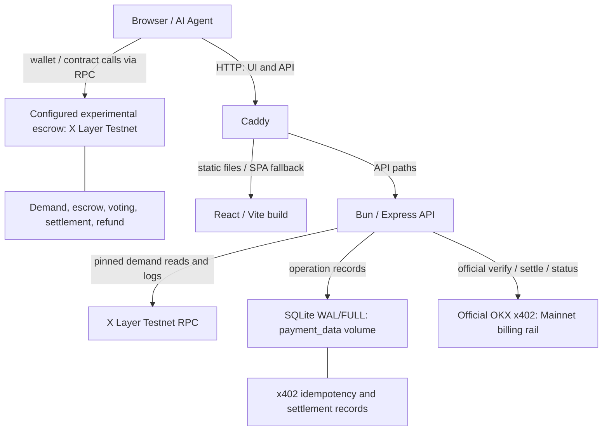

# Architecture

## Production paths



The browser's demand actions use `frontend/contract.ts` directly, not the Bun API. `frontend/main.tsx` lazy-loads app routes; `/` is the landing page, `/docs` serves the Vite MPA public API document at `frontend/docs/index.html`, and `/market`, `/market/:demandId`, `/create-demand`, `/analytics` are app routes.

Docker starts `backend/start.ts` through `docker/Dockerfile.api`; Caddy serves the web image and proxies `/v1`, `/v1/*`, `/live`, `/health` and `/ready`. One **Bun API replica** owns a local payment volume. Indexes, quotas and admission limits are process-local. SQLite and OKX do not share an atomic transaction; no distributed exactly-once guarantee is made. See [Self-hosting](SELF_HOSTING.md) and [Payment recovery](PAYMENT_RECOVERY.md).

The active public site is [https://unmetxyz.my.id](https://unmetxyz.my.id).

## Local G0.2 validation source

The repository also contains a separate Bun validation runtime, described in [API](API.md#standalone-g02-validation-runtime). Its dependency path is `validation-service` → `validation-config`, `validation-evaluator`, `validation-codec` and `validation-transport`. It uses a local read-only ABI for chain reads and does not import the existing payment runtime, SQLite storage or API entrypoint. It is not wired into the production Compose deployment.

The runtime pins demand, nonce and ERC-1271 reads to a canonical block hash, checks the block again after evaluation, and verifies enabled token decimals at startup. It verifies builder authorization before unpaid target inspection. A separate authenticated Unix-socket signer owns the verifier key, accepts only the attestation type and allowlisted deployment/policy, and returns a signature the validator independently recovers before PASS. Isolation protects the key but does not establish the truth of a compromised validator's observations. No deployment or production readiness follows from local tests; they do not establish VPS firewall, namespace, mount, secret or egress isolation. Onchain consumption and replay prevention are implemented in the local G0.4 AgentDemand source; frontend/backend integration remains G0.5.

## Independent network contexts

The demand market is configured by `CHAIN_ID` and remains on X Layer Testnet (`1952`): contract reads, indexing, frontend writes, escrow, and health/readback reporting use this network. `PAYMENT_TOKEN` is the Testnet escrow token.

Only the x402 middleware for `POST /v1/opportunities` uses `X402_CHAIN_ID`. Production sets it explicitly to X Layer Mainnet (`196`) and advertises three fixed native EIP-3009 assets. `X402_RPC_URL` independently confirms Mainnet settlement receipts; it is never sourced from the market Testnet RPC. This payment setting is never used by `backend/contract.ts` or demand-market clients.

`backend/AgentDemand.sol` is the canonical escrow source. AgentDemand is the only supported escrow protocol; no dual-version runtime is planned. G0.4 replaces Solidity source/tests without deploying or migrating funds. Existing frontend/backend ABI consumers and indexer behavior remain experimental until canonical AgentDemand G0.5 integration. The old `backend/admin.ts` deploy flow targets the removed experimental contract/artifact and encodes its six-argument constructor. A canonical build now emits `out/AgentDemand.sol/AgentDemand.json` at the same pathname, with an eight-argument constructor. That deploy command must not be used for canonical AgentDemand; deployment-tool integration remains G0.5. Live addresses and onchain state are unchanged. The backend derives demand information from blockchain state. Self-hosted `bun:sqlite` persists x402 payment/idempotency and settlement records; it is not an escrow database. There is no database server, Redis or offchain demand authority.

## Free discovery and paid intelligence

`GET /v1/demands` retains its public market fields and legacy score for API compatibility. The frontend reads the contract directly; its board, detail and analytics views do not consume either API response.

`POST /v1/opportunities` uses the same index and filters, with no additional RPC reads. It adds rank within the full matching pool before the response limit, a reproducible score breakdown, current escrow per historically expected call, remaining deadline/review time, review gaps, and deterministic reasons and cautions. Requested response order remains independent of score rank. Percentile tables are prepared once per pool; premium row enrichment applies only to the returned rows.

Premium serialization executes after the existing official payment middleware. SDK response buffering and durable settlement confirmation continue to control release. Free and unpaid challenge responses contain no new premium fields. All existing onchain facts remain public; paid value is the scoped comparison and interpretation. Scores are relative signals, and escrow is not guaranteed builder earnings. See [API calculations and examples](API.md#deterministic-demand-score).

## Canonical attestation

AgentDemand accepts only the five-argument `submitService(demandId, serviceUrl, evidenceHash, attestation, verifierSignature)`. The G0.3 `ValidationAttestation` EIP-712 domain is `UNMET AgentDemand`, version `2`, the current chain ID and this contract, without salt. The signature binds every typed field, the caller, exact URL bytes, evidence and next submission nonce. Time bounds are `issuedAt <= now + 60`, `issuedAt < expiresAt`, lifetime at most 900 seconds and `now < expiresAt`.

Only the current verifier's canonical 65-byte low-s ECDSA signature is accepted. The immutable `verifierAdmin` may only rotate that verifier through `setVerifier`; rotation is immediate and leaves accepted proposals and escrow rights unchanged. Submission atomically advances `submissionNonce`; invalid attempts do not consume it, and reopen never resets it. `submissionDigests(demandId, nonce)` preserves authenticated payment-requirements and validation-policy hashes across proposals. Voting, finalization, reopen and refunds require no verifier availability.

## Contract state

`Demand` stores:
- creator and submitted builder
- max unit price
- current committed bounty
- immutable-per-review `reviewCommitted`
- immutable-per-review `approvalRequired`
- expected calls
- deadline / review end
- supporting-wallet count
- lifecycle status
- capability / specification
- submitted service URL / evidence hash

Per-supporter mappings store commitment, expected calls and approval for the current submission nonce.

## Demand lifecycle

```text
OPEN
 | support
 | submit
 v
SUBMITTED
 | quorum reached -> finalize ----------------> FULFILLED
 |
 | rejection threshold reached, or review ends below quorum
 | while demand deadline is active
 v
reopen -> SubmissionRejected -> OPEN

OPEN after deadline --------------------------> supporter refunds
SUBMITTED after deadline + review end
  and below quorum ---------------------------> supporter refunds
last refundable balance withdrawn from a non-fulfilled demand -> CLOSED
```

Important invariants:
- New support is disabled during review, so the approval denominator cannot move.
- `approvalRequired` is a ceil-rounded snapshot created at submission.
- Refunds cannot lower the threshold for an existing submission.
- A submission that reached quorum is not refundable before settlement; after fulfillment, eligible non-approver commitments remain refundable.
- `FULFILLED` remains the lifecycle state after eligible non-approver refunds, including the final such refund; `CLOSED` applies when a non-fulfilled demand has no remaining refundable balance.
- Approvals are scoped to `submissionNonce`; old votes never carry into a new candidate.
- Approvers may not also reject the same submission. Rejection weight is measured against the review snapshot; reaching `reviewCommitted - approvalRequired + 1` makes quorum impossible and permits immediate reopen before the demand deadline.
- Reopening emits `SubmissionRejected` and clears candidate-specific vote progress. The demand returns to `Open` while its deadline remains active.
- Refunds are pull-based; there is no unbounded payout loop.
- Expired demand can be replaced by a new exact demand even before every old supporter refunds. An old refund cannot clear the replacement's active key.
- Contract computes the exact duplicate key itself from the validated capability slug + specification.

## Exact duplicate semantics

Capability is a canonical lowercase slug: `[a-z0-9]+(-[a-z0-9]+)*`, maximum 64 bytes.

`demandKey = keccak256(abi.encode(keccak256(bytes(capability)), keccak256(bytes(specification))))`

This prevents callers from bypassing exact-duplicate checks with an arbitrary key. It intentionally does **not** perform semantic similarity matching.

## Token accounting

UNMET assumes a normal ERC-20 accounting model. `_pullExact()` compares contract balance before and after `transferFrom`; fee-on-transfer/rebasing behavior that changes the received amount is rejected.

`finalize()`:
1. checks fixed quorum snapshot
2. sets terminal state before transfers
3. treats explicit `approvalWeight` as the approved settlement amount
4. removes only that amount from current escrow and total escrow accounting
5. calculates the protocol fee from the approved amount and transfers the net to the builder
6. leaves non-approver escrow in the fulfilled demand for individual refunds

`refund()` zeroes the caller's entitlement before transfer.

## Backend derived index

The API keeps a disposable in-memory index:
1. initial start reads `nextDemandId` and every demand
2. later requests read only demand IDs touched by contract logs since the indexed block
3. missing new IDs are detected from `nextDemandId`
4. indexed block hash is checked to detect a chain reorg
5. reorg / chain rewind triggers a full rebuild

A single in-flight refresh promise prevents duplicate concurrent rebuilds.

The cache is never used as proof. API results include chain ID, contract and indexed block so clients can verify them.

## OKX x402 flow

`POST /v1/opportunities` is the only paid route.

```text
validated request -> route/IP quota -> admission -> official x402 middleware
  unpaid -> HTTP 402 + PAYMENT-REQUIRED
  PAYMENT-SIGNATURE -> official verify
    -> durable SQLite reservation (self-hosted only)
    -> buffered chain-derived execution
    -> durable SETTLEMENT_IN_FLIGHT before official settle
    -> checkpoint returned hash -> verify canonical Mainnet L2 inclusion and token logs
    -> confirmed SETTLED -> release result + PAYMENT-RESPONSE
    -> ambiguous outcome -> UNKNOWN, withhold content, HTTP 409
```

The official Express SDK buffers execution **before settlement** and skips settlement on failed execution. Durable mode adds no custom payment signing, settlement or bypass; it preserves the official verifier and facilitator while independently correlating the persisted operation with canonical receipt evidence. Content remains blocked until strict facilitator success and persisted-receipt inclusion proof. Proof uses current canonical L2 inclusion, not safe/finalized or L1 finality, so sequencer/reorg risk remains. Duplicate/conflicting reservations return 409. Optional `Idempotency-Key` binds a logical request but never enables original paid-response replay. Status-only operator reconciliation never resubmits settlement; a missing hash can require manual investigation.

## Trust model

Trust minimized:
- committed funds, approvals, payout and refunds are onchain
- backend cannot mutate demand economics
- frontend cannot mark a tx successful until receipt status is successful

Remaining assumptions:
- supporters must inspect a candidate before approving
- successful bounty payout does not guarantee future service availability
- supporting wallets are not verified unique identities
- RPC/facilitator/frontends can be temporarily unavailable
- contract is not independently audited

## Economic field semantics

- `committed` is current escrow remaining in the demand.
- `reviewCommitted` snapshots total escrow at candidate submission and never changes during that review.
- `approvalRequired` is calculated once from the snapshot using ceil division.
- `approvalWeight` is the maximum amount eligible for settlement because only explicit approvers are paid through to the builder. The `DemandFulfilled` event's `approvedAmount` equals that weight; builder payout plus fee equals `approvedAmount`, never the full original pool by default.
- Non-approver funds remain refundable after successful fulfillment. Refunding reduces current escrow and the individual position, while aggregate supporter count and expected calls remain historical.
- `supporterCount` and aggregate `expectedCalls` are historical demand signals and are not decremented by later refunds.

This prevents a majority from seizing minority deposits while preserving the original demand signal.

## Why the core escrow is not ERC-8183

[ERC-8183](https://eips.ethereum.org/EIPS/eip-8183) was compared as a **Draft** in the original design rationale below. This retained comparison describes the specification inspected then; it does not claim incompatibility, superiority or a current standards review. ERC-8183 solves a neighboring problem at a different abstraction layer.

At a high level, ERC-8183 models a job:

**Client → fund one job budget → Provider submits → one Evaluator completes or rejects → release or refund the job escrow**

Its evaluator may be the client or a contract, and the specification includes optional hooks. The core escrow unit is still the budget for one job.

UNMET models funded market demand:

**Many supporters → independently commit to one demand → one builder submits a candidate → supporters vote with commitment weight → quorum uses the review escrow snapshot → only explicit approver funds settle; eligible non-approver funds remain individually refundable**

| Dimension | UNMET | ERC-8183 core job |
| --- | --- | --- |
| Funding | Multiple wallets make independent commitments to one demand. | A client funds one job budget. |
| Evaluation authority | Supporters vote with commitment weight; the contract checks approval quorum against the snapshot taken at submission. | One evaluator address decides whether a submitted job completes or is rejected. The evaluator may be the client or a contract. |
| Settlement | Only explicit approver commitments are eligible for builder payout and treasury fee. Eligible non-approver commitments do not automatically pay the builder and remain individually refundable. | The job escrow is the settlement unit: completion releases it to the provider (less an optional fee); rejection or expiry refunds it to the client. |
| Market discovery | The demand can be funded and discovered before a builder is selected. | The primitive coordinates execution after the job's client, provider, evaluator, and budget are established. A provider may be assigned after creation, but must be set before funding. |
| Re-proposal | An unsuccessful candidate can be cleared and the demand reopened while its deadline remains active, preserving the underlying demand. | Rejected and expired jobs are terminal in the specified state machine, so another attempt would use a new job. |

These differences explain why `AgentDemand` uses a demand-level escrow and commitment ledger as its core. They do not imply that ERC-8183 cannot be extended or composed for a particular application.

One possible future composition would match a funded UNMET demand to a provider, then use an ERC-8183-compatible job escrow downstream for that provider's execution. `AgentDemand` could remain the demand-aggregation and commitment-consensus layer. UNMET does not implement this integration today.
